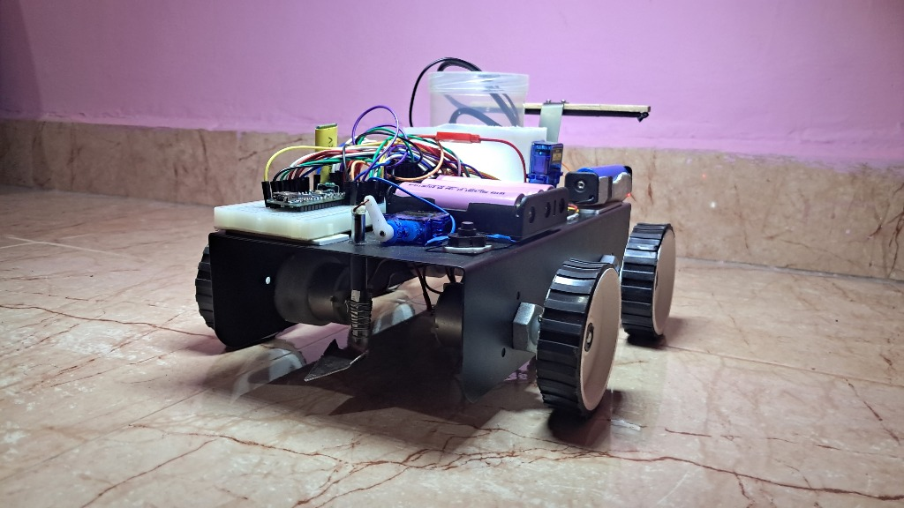
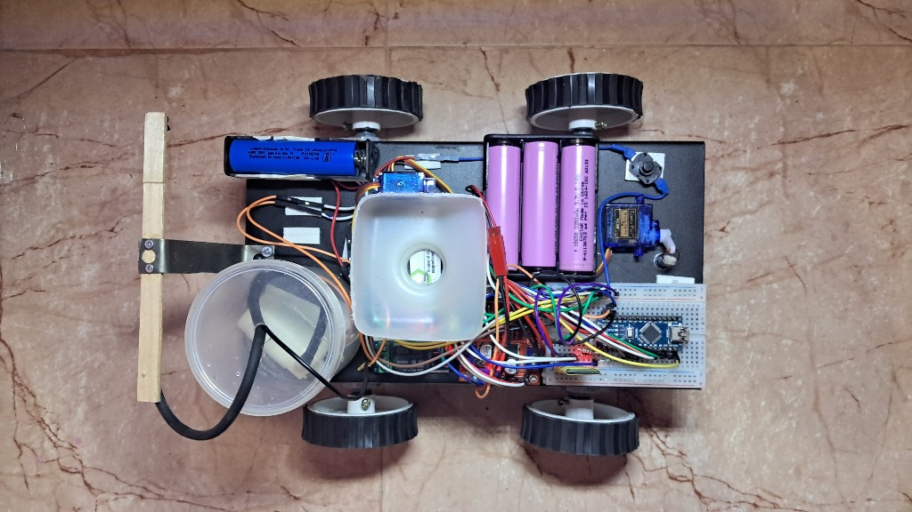
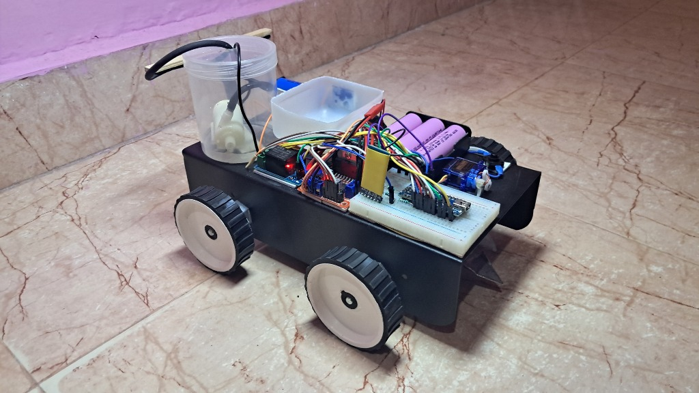

# Smart Ploughing and Cultivation Agriculture Robot

[](https://github.com/buildprojecthq/agribot/releases/tag/v1.0.0)
[](https://www.arduino.cc/)
[](https://github.com/buildprojecthq/agribot/releases/tag/v1.0.0)
[](https://buildproject.in/)

A multi-functional, Bluetooth-controlled agricultural mobile robot engineered for precision farming. The system coordinates **4-wheel differential drive locomotion**, **mechanical soil tillage / furrowing**, **metered seed dispensing**, and **pressurized liquid pesticide spraying** through an Arduino Nano microcontroller and a companion Native Android application.

---

## 📸 Hardware Prototype Showcase

### 1. Front Profile & Mechanical Tillage Assembly
<p align="center">
  
</p>

> **Front-Angle Overview:** Ground-level frontal perspective illustrating the mechanical plough blade linkage, high-traction agricultural tires, and robust chassis clearance.  
> **Operational Functionality:** Demonstrates the front servo-actuated tillage mechanism calibrated to penetrate and furrow topsoil at $120^\circ$ and lift to $72^\circ$ for road transit.

---

### 2. Top-Down Architectural Layout & Subsystem Integration
<p align="center">
  
</p>

> **Overhead Layout View:** Orthographic bird's-eye view detailing the symmetrical component placement, balanced weight distribution, and modular subsystem isolation.  
> **Operational Functionality:** Showcases the central seed agitation hopper, rear fluid reservoir with spray bar, Arduino Nano breadboard bus, and dual-battery power banks.

---

### 3. Isometric Side Profile & Actuation Integration
<p align="center">
  
</p>

> **Isometric Perspective:** Elevated three-quarter perspective highlighting the pressurized irrigation plumbing, optocoupled relay switch, and wireless Bluetooth node.  
> **Operational Functionality:** Displays the point-to-point wiring harness, L298N finned heatsink, and submersible pump assembly integrated seamlessly onto the 4WD mobile chassis.

---

## 1. System Architecture

```
+----------------------------------------------------------------------------------+
|                           NATIVE ANDROID COMPANION APP                            |
|   [ Auto-Connect HC-05 ]    [ Centered D-Pad Steering ]    [ Tool Actuation Toggles]
|                       [ Built by buildproject.in ]                               |
+----------------------------------------------------------------------------------+
                                         |
                                (Bluetooth SPP / UART 9600)
                                         v
+----------------------------------------------------------------------------------+
|                            HC-05 BLUETOOTH MODULE                                 |
|                       RX (Pin D3 via Divider) | TX (Pin D2)                      |
+----------------------------------------------------------------------------------+
                                         |
                                         v
+----------------------------------------------------------------------------------+
|                            ARDUINO NANO R3 (ATmega328P)                          |
|             (Non-blocking millis() state machine + 50Hz Software PWM + Watchdog) |
+----------------------------------------------------------------------------------+
        |                     |                       |                     |
        v                     v                       v                     v
  [ Pins D4-D7 ]          [ Pin D10 ]             [ Pin D9 ]            [ Pin D12 ]
        |                     |                       |                     |
  L298N Motor Driver      Tool Servo              Tool Servo        1-Ch Relay (Active-LOW)
  (50Hz Speed Modulated)  (Plough Lifter)         (Seed Agitator)   (Water / Pesticide)
        |                     |                       |                     |
  4x Geared DC Motors     Tillage Blade           Seed Hopper Gate      12V DC Water Pump
  (Skid-Steer 4WD)        (Deploy 120° / Ret 72°) (Agitate 73° - 123°)  (Pressurized Spray)
```

---

## 2. Dual-Isolated Power Architecture (Method 2)

To completely eliminate motor back-EMF, ground bounce, and brownout microcontroller resets, the robot separates high-power motor loads from sensitive digital logic:

| Power Bus | Voltage | Source | Components Powered |
| :--- | :--- | :--- | :--- |
| **High-Current Drive Bus** | **11.1V – 12.6V** | 3S 18650 Li-ion Battery Pack | L298N `+12V` terminal (4x wheel motors) & Water Pump via Relay |
| **Clean Logic Bus** | **5.0V Regulated** | Single 18650 Cell + SM5401 Boost | Arduino Nano `5V` pin, HC-05 `VCC`, SG90 Servos `VCC`, L298N `+5V` logic |
| **Common Ground** | **0V Reference** | Unified Ground Bus | Unites Battery (-), SM5401 (-), Nano GND, and L298N GND |

> [!IMPORTANT]
> The L298N onboard **5V-EN jumper cap is REMOVED**, keeping the 12V motor supply isolated from the 5V logic supply while sharing a common ground.

---

## 3. Hardware Pin Mapping

| Arduino Nano Pin | Connected Component | Functionality / Calibration |
| :---: | :--- | :--- |
| **`D2`** | HC-05 Bluetooth `TXD` | SoftwareSerial RX (Receives telemetry packets) |
| **`D3`** | HC-05 Bluetooth `RXD` | SoftwareSerial TX (via 1kΩ / 2kΩ level shifter divider) |
| **`D4`** | L298N `IN1` | Left Motors Forward control |
| **`D5`** | L298N `IN2` | Left Motors Reverse control |
| **`D6`** | L298N `IN3` | Right Motors Forward control |
| **`D7`** | L298N `IN4` | Right Motors Reverse control |
| **`D9`** | Seed Dispenser Servo (SG90) | Metered oscillating agitation gate ($73^\circ \leftrightarrow 123^\circ$) |
| **`D10`** | Plough Lifter Servo (MG996R/SG90) | Mechanical tillage blade lifter ($72^\circ \leftrightarrow 120^\circ$) |
| **`D12`** | 1-Channel Relay Module | Optocoupled Active-LOW switch for 12V Water Pump |
| **`D13`** | Onboard Status LED | Command acknowledgment blinker & watchdog indicator |
| **`5V`** | Breadboard 5V Rail | Regulated power input from SM5401 boost module |
| **`GND`** | Breadboard Blue Rail | System common ground |

---

## 4. Communication Protocol (Single-Byte ASCII)

Commands are transmitted over Bluetooth SPP at **9600 baud, 8-N-1**:

| Byte | Subsystem | Action Performed | Hardware State |
| :---: | :--- | :--- | :--- |
| **`'F'`** | Locomotion | Forward Drive | Left FWD, Right FWD (Modulated at 75% duty cycle) |
| **`'B'`** | Locomotion | Backward Drive | Left REV, Right REV (Modulated at 75% duty cycle) |
| **`'L'`** | Locomotion | Skid-steer Left Turn | Left REV, Right FWD (Modulated at 75% duty cycle) |
| **`'R'`** | Locomotion | Skid-steer Right Turn | Left FWD, Right REV (Modulated at 75% duty cycle) |
| **`'S'`** | Locomotion | Emergency / Released Stop | All motor driver pins driven LOW |
| **`'P'`** | Tillage | Deploy Plough into Soil | Servo D10 rotates to $120^\circ$ and auto-detaches |
| **`'p'`** | Tillage | Retract Plough for Transit | Servo D10 rotates to $72^\circ$ and auto-detaches |
| **`'D'`** | Seeding | Start Seed Sowing | Servo D9 agitates $73^\circ \leftrightarrow 123^\circ$ every 20ms |
| **`'d'`** | Seeding | Stop Seed Sowing | Servo D9 moves to $73^\circ$ (closed) and auto-detaches |
| **`'W'`** | Irrigation | Water Pump ON | Pin D12 driven LOW (Active-LOW relay closed) |
| **`'w'`** | Irrigation | Water Pump OFF | Pin D12 driven HIGH (Relay opened) |

---

## 5. Firmware Technical Highlights

1. **Software Duty-Cycle Speed Control (~25% Slower):**
   * Implements a non-blocking $50\text{ Hz}$ ($20\text{ ms}$) software PWM loop in `firmware.ino` (`MOTOR_DUTY_PERCENT = 75`).
   * Delivers smooth, controlled field navigation without needing extra hardware wiring to ENA/ENB pins.
2. **2000 ms Fail-Safe Watchdog:**
   * If the mobile device loses connection or leaves Bluetooth range during driving, the watchdog timer halts all locomotion after 2 seconds.
3. **Brownout & Servo Protection:**
   * High-torque servos automatically detach their PWM signals (`servo.detach()`) after reaching the target position, eliminating continuous stall current and saving battery.
4. **Boot Glitch Prevention:**
   * Relay pin D12 is preset to `HIGH` before `pinMode(OUTPUT)` is declared, ensuring zero relay chatter or false pump activations during boot.

---

## 6. Native Android Companion App

* **Auto Bluetooth Management:** Automatically checks permissions, turns on Bluetooth, discovers the paired **`HC-05`** module, and connects instantly on launch.
* **Touch-and-Hold Steering:** Intuitive D-Pad controls where holding down an arrow drives the robot and releasing instantly stops.
* **Pixel-Perfect Obsidian UI:** Modern high-contrast dark theme with centered button geometry and haptic feedback.
* **Direct Web Integration:** Footer includes an interactive link to [`https://buildproject.in/`](https://buildproject.in/).

---

## 7. Project Resources & Downloads

* **Production Release APK:** [SmartAgriRobot-release.apk (GitHub Release v1.0.0)](https://github.com/buildprojecthq/agribot/releases/tag/v1.0.0)
* **Viva & Components PDF Guide:** [Smart_Agri_Robot_Viva_and_Components_Guide.pdf](file:///home/yashas/Projects/miniproject_agriculture_bot/Smart_Agri_Robot_Viva_and_Components_Guide.pdf)
* **Relay Benchtop Test Utility:** [`test_relay/test_relay.ino`](file:///home/yashas/Projects/miniproject_agriculture_bot/test_relay/test_relay.ino)

---

## 8. Authors & Credits

* **Developer:** Yashas R
* **Project Platform:** [buildproject.in](https://buildproject.in/)
* **Repository:** [buildprojecthq/agribot](https://github.com/buildprojecthq/agribot)
